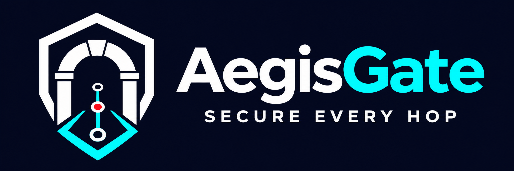
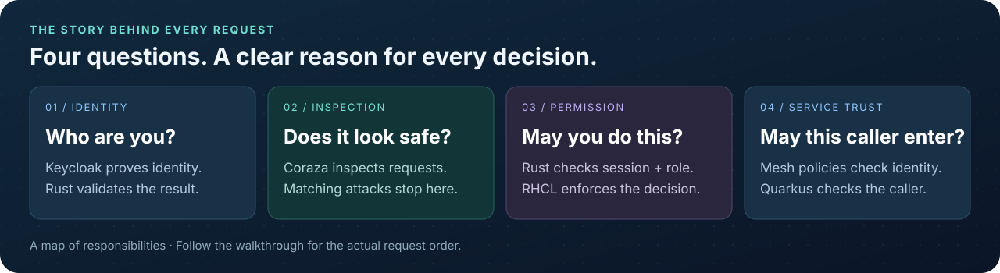
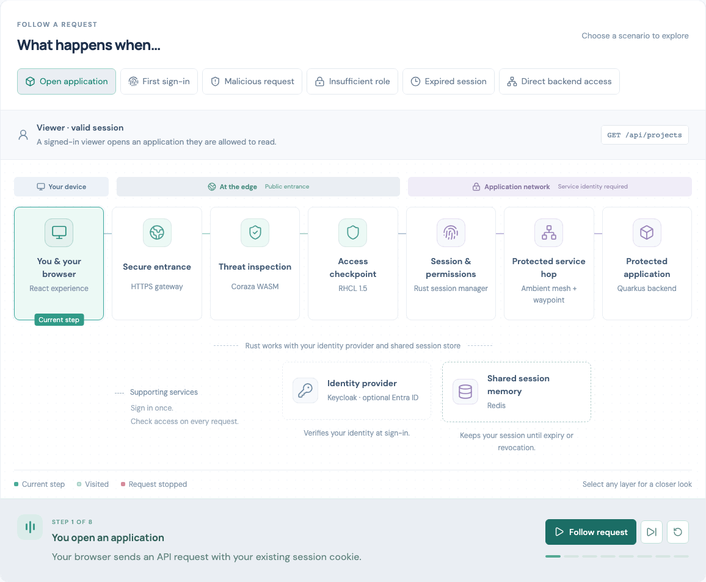
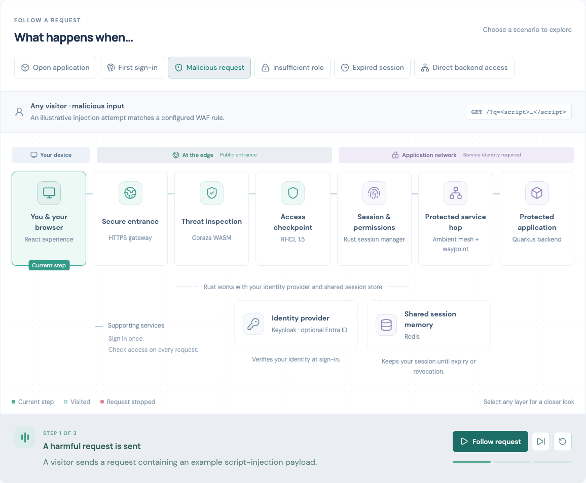

<div align="center">

# AegisGate · The access story

**From a first click to a protected application. Understand every decision along the way.**

[**Read the illustrated guide**](docs/how-it-works.md) · [**Try the interactive walkthrough**](docs/getting-started.md#explore-the-walkthrough) · [**Run it yourself**](#run-locally)

*Rust sessions · React experience · Quarkus application · Apache 2.0*

</div>

---

## Begin with a question

You sign in. You open an application. You try an action. **What decides whether it succeeds?**

AegisGate makes that journey visible. Follow a request through identity, attack
inspection, session checks, permissions, and service boundaries—with a working
demo behind the explanation.



[Open the visual map at full size →](docs/assets/book-map.svg)

**New to the project?** Start with [one successful request](docs/how-it-works.md#01-open-an-application).
You can read the whole story without installing anything.

## Choose your next page

| **Explore the story** | **Try the protection** | **Build the system** |
| --- | --- | --- |
| Follow six visual journeys and discover why each request is allowed or stopped. | Sign in, compare roles, test the WAF, and revoke a session. | Run locally or deploy the operator-managed stack through GitOps. |
| [Start reading →](docs/how-it-works.md) | [Open the browser demo guide →](docs/demo-guide.md) | [Local setup →](docs/getting-started.md) · [OpenShift GitOps →](deploy/gitops/DEPLOYMENT.md) |

## Turn the page: what happens when…

Expand a story for a quick preview. Each animation has a full written chapter
and a still image, so you can explore at your own pace.

<details>
<summary><strong>01 · I open an application I am allowed to use</strong></summary>

A viewer requests `GET /api/projects`. Coraza inspects the request; RHCL consults
Rust; Redis supplies a valid session. Rust checks permissions again, the backend
waypoint verifies its service identity, and Quarkus returns the data.



**The takeaway:** every protected request gets checked, even after a successful login.

[Read the eight steps and view the still image →](docs/how-it-works.md#01-open-an-application)

</details>

<details>
<summary><strong>02 · I sign in for the first time</strong></summary>

Keycloak verifies your identity. Rust validates the signed result, maps your roles,
and creates a Redis session. Your browser receives an opaque HttpOnly cookie;
React does not receive the provider tokens.

**The takeaway:** identity-provider sign-in and the application's own session are separate.

[Follow first sign-in →](docs/how-it-works.md#02-first-sign-in)

</details>

<details>
<summary><strong>03 · Someone sends a malicious request</strong></summary>

A script-injection-shaped query reaches the Gateway. A configured Coraza rule
matches and stops it before it reaches the application.



**The takeaway:** public routes still receive WAF inspection.

[See where the request stops →](docs/how-it-works.md#03-malicious-request) · [Try the browser test →](docs/demo-guide.md#2-watch-coraza-stop-a-test-request)

</details>

<details>
<summary><strong>04 · I am signed in, but my role does not allow an action</strong></summary>

A viewer attempts `POST /api/deployments`. The session is valid, but this action
requires an operator or administrator. Rust denies it and RHCL stops the request.

**The takeaway:** knowing who you are does not grant every permission.

[Explore the denied action →](docs/how-it-works.md#04-insufficient-role) · [See the role matrix →](docs/identity-and-sessions.md#the-permission-matrix)

</details>

<details>
<summary><strong>05 · My session expires or an administrator revokes it</strong></summary>

The browser may still have a cookie, but the Redis session is no longer usable.
The next check denies access. Sessions have a **15-minute idle limit** and a
**maximum of one hour**, capped by the verified ID token's expiry.

**The takeaway:** the server-side session controls access; the cookie alone cannot restore it.

[Follow an expired session →](docs/how-it-works.md#05-expired-session) · [Understand both clocks →](docs/identity-and-sessions.md#two-clocks-limit-every-application-session)

</details>

<details>
<summary><strong>06 · Another workload tries to bypass the Gateway</strong></summary>

The backend waypoint accepts the session-manager identity. The backend workload
accepts its waypoint identity. An unrelated caller cannot reach Quarkus merely
because it is inside the cluster.

**The takeaway:** user permissions and service identities protect different boundaries.

[Follow the bypass attempt →](docs/how-it-works.md#06-direct-backend-access) · [Inspect the real topology →](docs/architecture.md)

</details>

*These showcases explain the design; they do not send test traffic. The
[browser guide](docs/demo-guide.md) shows how to verify a running deployment.*

## The bookshelf

Read in order, or jump to the chapter that answers your question.

| Chapter | Inside |
| --- | --- |
| **[01 · How it works](docs/how-it-works.md)** | Six animated journeys, still images, and step-by-step explanations |
| **[02 · Behind the picture](docs/architecture.md)** | Actual routes, the separate Authorino decision call, and waypoint boundaries |
| **[03 · Identity, sessions, and roles](docs/identity-and-sessions.md)** | OIDC, cookies, Redis, session timelines, and permissions |
| **[04 · See it working](docs/demo-guide.md)** | Browser exercises, expected results, logs, and Kiali interpretation |
| **[05 · Your first local session](docs/getting-started.md)** | Install, sign in, choose a demo identity, and restart safely |
| **[06 · Deploy on OpenShift](deploy/gitops/DEPLOYMENT.md)** | Central Argo CD, operators, Vault/ESO, TLS, IPv6, and ambient mesh |
| **[Workshop · Build and extend](docs/development.md)** | Versions, AMD64/ARM64 images, additional providers, and tests |
| **[Editor's desk · Improve this book](docs/authoring.md)** | Writing conventions and repeatable showcase captures |

[Browse the full field guide →](docs/README.md)

## Run locally

Have **Docker with Compose, Python 3, curl**, and ports **8080 / 8180** available.
From the repository root:

```sh
./scripts/install-local.sh
```

Open **[localhost:8080](http://localhost:8080)** and choose **Start a secure session → Keycloak**.

| Choose an identity | What you can explore | Generated password in `.env` |
| --- | --- | --- |
| `viewer` | Read applications and see privileged actions denied | `DEMO_VIEWER_PASSWORD` |
| `operator` | Read applications and run the sample operator action | `DEMO_OPERATOR_PASSWORD` |
| `admin` | Inspect sessions, revoke access, and view the activity log | `DEMO_ADMIN_PASSWORD` |

Passwords are generated during installation. Keep `.env` and `deploy/generated/`
out of Git. [Continue with the local setup chapter →](docs/getting-started.md)

**Local Compose** demonstrates login, sessions, RBAC, CSRF, and the application.
**OpenShift GitOps** adds RHCL, Coraza, ambient mTLS, and waypoint enforcement.
The operator action is a sample business response; it does not deploy a workload.

## Take it to the cluster

The example deployment combines **RHCL 1.5**, **Service Mesh 3.5 ambient mode**,
**Coraza WASM**, the **Keycloak Operator**, and **Redkey**, with secrets synchronized
from Vault by ESO. Central Argo CD runs on a management cluster and reconciles four applications on your workload cluster.

[**Before you deploy: platform prerequisites →**](deploy/gitops/PREREQUISITES.md)

[**Continue with the OpenShift GitOps guide →**](deploy/gitops/DEPLOYMENT.md)

[Identity setup](deploy/gitops/README.md) · [Redis setup](deploy/gitops/redis/README.md) · [Application policies](deploy/gitops/application/README.md)

<details>
<summary><strong>What has been verified, and what are the demo boundaries?</strong></summary>

The public GitOps manifests use example hostnames and platform settings.
[Configure your deployment](deploy/gitops/DEPLOYMENT.md) before syncing, then
follow the [verification guide](docs/demo-guide.md#deployment-verification).
Local validation does not establish live cluster enforcement.

Redis is ephemeral: restarting it clears sessions and the bounded demo activity
log. Application sessions do not silently refresh provider tokens or pick up
later provider role changes. The supplied Keycloak deployment has one instance.
These are deliberate demo limits, not a production availability or security certification.

[Read the development reference and boundaries →](docs/development.md#demo-boundaries)

</details>

---

**Ready for chapter one? [Follow your first request →](docs/how-it-works.md)**

[Public repository safety](SECURITY.md) · [Apache License 2.0](LICENSE) · [Source and build reference](docs/development.md) · [Help improve the documentation](docs/authoring.md)
