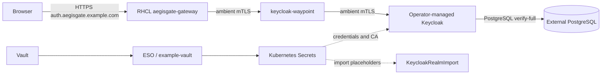

# Keycloak first, through GitOps

For the complete platform checklist, start with
**[Before you deploy](PREREQUISITES.md)**, including mesh, RHCL, cert-manager,
operator watch scopes, Vault records, PostgreSQL, and central Argo access.

For the complete central Argo CD deployment, use the
[Example bootstrap guide](DEPLOYMENT.md), including TLS policies and Gateway readiness.

Redis session storage now has a separate [Redkey Operator GitOps application](redis/README.md),
using the existing Vault `aegisgate/redis` record, ambient mode, and a TCP waypoint.
The [application GitOps deployment](application/README.md) adds React, Rust,
Quarkus, app waypoints, Coraza, and RHCL session authorization.

This deployment uses your **installed Red Hat Keycloak Operator 26.8.2** and
**ESO `ClusterSecretStore/example-vault`**. Argo CD manages the custom resources;
the Keycloak Operator owns the server StatefulSet, Services, and import Job.
No credentials, standalone Keycloak Deployment, database installation, or
operator Subscription are included.



Public issuer: `https://auth.aegisgate.example.com/realms/aegisgate`.
Application origin: `https://demo.aegisgate.example.com`.
Exact OIDC callback: `https://demo.aegisgate.example.com/auth/callback`.

The confidential client requires authorization code + PKCE S256. Password grants,
implicit flow, and client service accounts are disabled. The three demo users
receive their corresponding `aegis-viewer`, `aegis-operator`, and `aegis-admin`
realm roles, also mapped into the ID token for the Rust session manager.

## Resources and ownership

| GitOps application | Path | Namespace |
| --- | --- | --- |
| `aegisgate-gateway` | `deploy/gitops/gateway/overlays/example` | `aegisgate` |
| `aegisgate-keycloak` | `deploy/gitops/keycloak/overlays/example` | `aegisgate-identity` |
| `aegisgate-redis` | `deploy/gitops/redis/overlays/example` | `aegisgate-cache` |
| `aegisgate-application` | `deploy/gitops/application/overlays/example` | `aegisgate` (shared, owned by Gateway application) |

All three example namespace overlays patch their Namespace with the mesh discovery label
`ambient-single-mesh: example-mesh`. The shared resources do not hard-code this
cluster-specific label. For another cluster, create corresponding Gateway,
Keycloak, and Redis overlays, change the discovery label key/value to match that cluster's
mesh selector, and point its Argo CD Applications at those overlays. These patches
target only Namespace resources; they do not change workload selectors. The
Keycloak namespace's separate `istio.io/dataplane-mode: ambient` label remains
responsible for ambient enrollment.

The Applications and dedicated `aegisgate` AppProject live in the example
central `argocd` namespace. Their destination is the placeholder
`https://api.cluster.example.com:6443`. Register your own workload cluster and
customize the destination before syncing. The bootstrap renders five central
Argo resources. All four Applications use manual sync and this repository's
`main` branch; pin a reviewed commit for a reproducible release.

The example overlays remove the local OpenShift GitOps `managed-by` label:
access comes from your registered remote-cluster credentials. The AppProject
limits source repository, destinations, and resource kinds. Keep credentials
outside Git. See [deployment setup](DEPLOYMENT.md) for all required substitutions.

The Gateway has two HTTPS listeners: `https` for the application and
`keycloak-https` for identity. The Keycloak HTTPRoute lives with its backend in
`aegisgate-identity`; the listener explicitly permits that namespace. No
cross-namespace backend ReferenceGrant is needed. There is no direct OpenShift
Route or operator-managed Ingress to Keycloak.

## Existing Vault records

These remote keys are relative to the Vault mount configured on `example-vault`.
They assume `spec.provider.vault.path: secret` and KV v2. ESO handles the `/data/`
API segment; do not add it to the keys below. The store must be Ready, allow
`aegisgate-identity`, and have read access to these records.

| Vault path, below `secret/` | Fields used | Resulting Kubernetes Secret |
| --- | --- | --- |
| `aegisgate/postgresql` | `host`, `port`, `database`, `username`, `password`, `sslmode` | `keycloak-db` |
| `aegisgate/postgresql` | `sslrootcert_pem` | `keycloak-db-ca` |
| `aegisgate/keycloak/bootstrap` | `username`, `password`, `realm` | `keycloak-bootstrap` |
| `aegisgate/keycloak` | `client_id`, `client_secret`, `realm` | `keycloak-realm` |
| `aegisgate/keycloak/users/{admin,operator,viewer}` | `username`, `password`, `realm`, `role`, `temporary` | `keycloak-realm` |

The backend token is deliberately not needed for this first deployment. Credentials are supplied by ESO, not committed values.

The bootstrap record's `realm` must be **`master`**: Keycloak creates its bootstrap
administrator there. Demo users belong to **`aegisgate`**; their stored roles must
match the paths above and `temporary` must be the JSON boolean `false`, matching
the expected record schema. ESO fails validation on incompatible values instead of
silently changing their meaning. The bootstrap account is separate from the
application's `admin` user; establish a permanent administrator after bootstrap.

The existing PostgreSQL database must already exist and the Vault user must have
DDL privileges for Keycloak's tables. The JDBC URL uses the Vault host, port, and
database; it requires `sslmode=verify-full` and the PEM CA from Vault. The operator
mounts that CA through its supported `truststores` field at
`/opt/keycloak/conf/truststores/secret-keycloak-db-ca/root.pem`. The database's
certificate must match the configured hostname. No database creation or password
change is performed by these manifests. Use a database/schema reserved for this
Keycloak instance; do not point another independent Keycloak installation at it.

## Platform prerequisites before syncing

1. The installed Keycloak Operator must watch **`aegisgate-identity`**, and its
   service account must have access there. An installation in another namespace
   does not imply cluster-wide watches. Check its OLM OperatorGroup, CSV supported
   install modes, and operator `WATCH_NAMESPACE`; reconcile any scope change in
   the existing operator's GitOps source. This repository does not install a
   second operator or guess an existing OperatorGroup name.
2. ESO must serve `external-secrets.io/v1`. Keycloak and KeycloakRealmImport must
   serve `k8s.keycloak.org/v2beta1`. The mesh must provide `istio` and
   `istio-waypoint` GatewayClasses and discover both AegisGate namespaces.
3. Enable **`ENABLE_INGRESS_WAYPOINT_ROUTING=true`** in the existing Istio control
   plane's configuration. The Service's two waypoint labels alone do not enable
   ingress-to-waypoint routing. Reconcile this setting in the existing Service
   Mesh installation's GitOps source, using the installed operator's API.
4. The example overlay includes an RHCL **TLSPolicy** using the example
   `ClusterIssuer/example-issuer`; configure your own issuer. It provisions separate
   `aegisgate-app-tls` and `aegisgate-auth-tls` Secrets for the two HTTPS listeners.
   The issuer uses Vault PKI; its signing role must allow both AegisGate hostnames.
   The Rust workload loads OpenShift's injected cluster trust bundle, which
   must include the CA needed by your deployment. Other overlays must configure their TLS
   source separately.

5. Route both public DNS names to the **RHCL Gateway's** external address. If the
   platform exposes gateways through an OpenShift router, its passthrough routes
   must target the Gateway Service, never the Keycloak Service.

Keycloak's namespace is enrolled in ambient mode. Its operator-managed Service
gets `istio.io/use-waypoint: keycloak-waypoint` and
`istio.io/ingress-use-waypoint: "true"` through `spec.http.labels`.
The workload requires mTLS and accepts application traffic only from the
waypoint's identity. The Service-targeted waypoint policy accepts only the ingress
Gateway identity. This denies direct Gateway-to-pod and workload-to-pod access on
8080. Policies assume the `cluster.local` trust domain and Istio-generated service
accounts `aegisgate-gateway-istio` and `keycloak-waypoint`; change the principals
if your installation uses different identities.

The management interface on port 9000 remains available **inside the cluster**
for the operator, health checks, and metrics. It has an explicit port-scoped mTLS
exception and no public route. NetworkPolicy allows HBONE and management traffic,
including ambient's kubelet probe addresses; it does not open plaintext 8080.
The operator's default NetworkPolicy is disabled because this GitOps policy
accounts for HBONE. This first deployment is one Keycloak replica; the restrictive
policies do not yet enable multi-replica cache clustering.

Keep session authorization policies targeted to the application's API HTTPRoute.
Requiring an existing AegisGate session on Keycloak's login endpoints would create
a login loop. An existing Gateway-wide Coraza plugin will also inspect this
hostname: test OIDC, form POSTs, and admin actions against its rules. This change
does not claim WAF enforcement or add broad login-path exclusions.

## Render and sync

```sh
kubectl kustomize deploy/gitops/gateway/overlays/example
kubectl kustomize deploy/gitops/keycloak/overlays/example
```

These renders contain references and templates, not resolved Vault values. After
the prerequisites and Git push, import `application-gateway.yaml` and
`application-keycloak.yaml` through your existing Argo CD bootstrap/UI. Sync the
Gateway application, then Keycloak. Namespaces are applied first; ESO and operator
resources reconcile asynchronously in the same subsequent wave. Missing Secrets
prevent workloads from starting until ESO creates them. No custom Argo health
override or hook that waits on unavailable custom-resource health is required.

Check the actual custom-resource conditions as well as Argo's sync state:

```sh
oc get clustersecretstore example-vault
oc -n aegisgate-identity get externalsecrets
oc -n aegisgate-identity wait --for=condition=Ready externalsecret --all --timeout=180s
oc -n aegisgate-identity wait --for=condition=Ready keycloak/keycloak --timeout=600s
oc -n aegisgate-identity wait --for=condition=Done keycloakrealmimport/aegisgate --timeout=600s
oc -n aegisgate get gateway aegisgate-gateway
oc -n aegisgate-identity get gateway keycloak-waypoint
oc -n aegisgate-identity get httproute keycloak -o yaml
curl --fail --silent --show-error \
  https://auth.aegisgate.example.com/realms/aegisgate/.well-known/openid-configuration
```

Verify HTTPRoute `Accepted`/`ResolvedRefs`, both Gateways' `Programmed` condition,
and the discovery document's exact public issuer. Confirm the generated Service
labels and use mesh telemetry to prove ingress → waypoint → Keycloak traversal.
Test direct Service/pod access from an unrelated workload: application access
must fail. A green Argo sync alone does not prove TLS, WAF, or mesh enforcement.

## Updates and boundaries

ESO refreshes hourly. The operator watches referenced runtime Secrets and rolls
Keycloak when relevant configuration changes; database password rotation still
requires coordination with PostgreSQL. Bootstrap credentials only initialize an
empty master realm. **Realm imports are create-once**: changing Vault user/client
passwords or editing redirect URIs in Git does not update an existing realm.
Use Keycloak administration for those changes and synchronize the Vault value
consumed by clients. Do not delete the realm/database to force a credential update.

Keep the RealmImport CR in Git to preserve its completed status across syncs.
The public realm name must be the literal `aegisgate`: the operator constructs
its Secret filename before expanding placeholders, so `${REALM}` is invalid
there. ESO validates the Vault realm name against this value; credentials still
use Secret-backed placeholders.
Its completed Job/Pod can remain for inspection. If cleaning up the import,
remove the CR from Git and prune it; ordinary deletion is recreated by the next
sync and still does not overwrite an existing realm.

Do not run `scripts/install-openshift.sh` against this setup. That older all-in-one
demo path deploys its own Keycloak and owns the same shared ingress Gateway; its
generated resources would conflict with this operator/GitOps installation.
Redis is prepared in its separate Redkey application. React, Rust, Quarkus, and
gateway protection are prepared in the separate application GitOps deployment;
sync them after the supporting services and Gateway are ready.

Validation performed locally: Kustomize rendering; 12 custom resources checked
against upstream Keycloak 26.8.2, ESO 1.0.0, Gateway API 1.3.0, and Istio 1.28.0
schemas; four tests covering ESO template rendering, credential preservation,
invalid record rejection, TLS downgrade rejection, Secret placeholder bindings,
and the OIDC client settings. Run the template tests with
`cd tests/gitops && go test -v ./...` from the repository root. These reference
schemas validate manifest shape, not installed product compatibility.
Validate against your installed CRD schemas before deployment. Admission,
reconciliation, and data-plane enforcement must be verified on your cluster.

References: [Keycloak Operator configuration](https://www.keycloak.org/operator/advanced-configuration),
[realm import lifecycle](https://www.keycloak.org/operator/realm-import),
[ESO templates](https://external-secrets.io/latest/guides/templating/),
[ingress waypoint routing](https://istio.io/latest/docs/ambient/usage/waypoint/),
[ambient NetworkPolicy](https://istio.io/latest/docs/ambient/usage/networkpolicy/).
