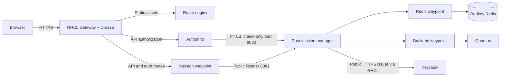

# AegisGate application GitOps deployment

`application-aegisgate.yaml` points Argo CD at `application/overlays/example` and
deploys the published React UI, Rust session manager, and Quarkus backend in
`aegisgate`. It consumes the separately managed Keycloak, Redkey Redis, and RHCL
Gateway. No operator, database, or Redis workload is recreated here.

Public application: **https://demo.aegisgate.example.com**.
Identity issuer: **https://auth.aegisgate.example.com/realms/aegisgate**.



## Ownership and synchronization

| Application | Owns |
| --- | --- |
| `aegisgate-gateway` | Shared `aegisgate` namespace and public Gateway/listeners |
| `aegisgate-keycloak` | Identity namespace, Keycloak CR/import, identity waypoint/routes |
| `aegisgate-redis` | Cache namespace, Redkey CR, Redis waypoint/policies |
| `aegisgate-application` | Three app workloads, app Secrets/configuration, app routes, WAF, AuthPolicy, app waypoints/policies |

The Gateway namespace now enables `istio.io/dataplane-mode: ambient`. Its Example
overlay supplies `ambient-single-mesh: example-mesh`; the application does not create
a second Namespace resource competing for ownership. Re-sync the Gateway
application before deploying the application. The gateway and waypoint proxies
use their controller-managed data planes; do not manually inject sidecars.

All three app images are pinned to the already-published `quay.io/arencloud`
multi-architecture indexes. Nodes select amd64 or arm64. The manifests request
one replica of each workload, use distinct ServiceAccounts, disable mounted API
tokens, and use non-root containers with read-only root filesystems and writable
temporary volumes. These are demo availability settings, not an HA deployment.

## Vault configuration

All ExternalSecrets use `ClusterSecretStore/example-vault`; remote keys are relative
to its `secret` KV-v2 mount. `example-vault` must allow the application namespace.

| Vault key | Application Secret | Used by |
| --- | --- | --- |
| `aegisgate/backend`, property `token` | `backend-token`, key `BACKEND_TOKEN` | Rust and Quarkus |
| `aegisgate/keycloak`, properties `realm`, `client_id`, `client_secret` | `session-manager-oidc`, keys `config.json`, `KEYCLOAK_CLIENT_SECRET` | Rust |
| `aegisgate/redis`, properties `username`, `password`, `database`, `port` | `session-manager-redis`, key `REDIS_URL` | Rust |

The Redis client ExternalSecret is included directly from `../redis/client`.
No credential values or rendered Secrets belong in Git. ESO safely serializes
the client ID into the JSON configuration; an empty client secret, short backend
token, mismatched realm, or unsupported Redis record fails reconciliation.

Rust uses secure `__Host-` cookies and the exact HTTPS application origin.
The configuration contains the same viewer/operator/admin permissions as the
working local demo. Role mappings use signed Keycloak ID-token claims. The
Keycloak import must already have the same Vault client ID/secret and exact
`https://demo.aegisgate.example.com/auth/callback` redirect URI. Changing Vault
does not update an existing Keycloak realm through `KeycloakRealmImport`.

After relevant Vault changes, wait for ESO and coordinate application rollouts:
environment variables are read at startup, and Rust loads configuration once.
Increment the pod annotation `aegisgate.example.com/secret-revision` through Git
to roll workloads. Rotating the shared backend token across two services is a
coordinated operation and can interrupt requests; this demo has no dual-token
rotation window. Redis and Keycloak rotations also require their server-side
updates, not just a Secret refresh.

## Routes and protection

- `/` serves static React assets from nginx. Its cluster configuration explicitly
  rejects `/api`, `/auth`, and `/internal` proxy paths. It cannot create an
  alternate route around the API AuthPolicy.
- `/auth` routes directly to the session-manager Service through its waypoint.
  Login/callback remain reachable before a session exists. Rust protects the
  session, administration, logout, and CSRF-sensitive endpoints itself.
- `/api` routes to the same Service with the `application-sessions` AuthPolicy.
  Authorino forwards the actual cookie, method, and path to `/internal/check`.
  A request is authorized only when the returned `allowed` value is true. The
  anonymous authentication stage only allows the pipeline to reach that check;
  it does not grant API access. Metadata caching is omitted to preserve revocation.
- `/internal/check` is served only on the dedicated cluster listener at port
  8082. Its pod policy allows only Authorino's exact mTLS identity. This listener
  serves only GET checks; it cannot proxy API requests or expose auth routes.
  Public port 8081 has no internal check route. The Gateway identity can reach
  only `/auth/*` and `/api/*` through the session waypoint.
- `/health/ready` on both hosts is owned by the Gateway application. It rewrites
  to Envoy's native `/healthz/ready` on an internal ClusterIP Service, port 15021.
  It needs no user session and reports Gateway readiness, not dependency health.
- The backend has no public route. Its waypoint accepts the Rust identity and
  the exact API methods/paths; Quarkus additionally validates the internal token
  and role. Workload policies accept application traffic only from the respective
  waypoints. Redis's existing policy already permits the Rust service account.

The WAF targets the **shared Gateway**, so it also covers the Keycloak listener.
It uses the supplied Coraza artifact, CRS, blocking mode (`SecRuleEngine On`),
`FAIL_CLOSE`, request-body inspection, and 64 KiB body limits. Response-body
inspection is disabled. Validate both application traffic and Keycloak login,
token exchange, and admin operations against CRS. Larger admin operations can
hit the body limit. Do not introduce broad auth-path bypasses to hide a false
positive; add a narrowly scoped, tested exclusion only if needed.

Pin the artifact's child image manifest (`40e483c6…`), not its multi-architecture
index (`b065d5ee…`). Istio verifies the resolved child manifest digest against
the URL digest; pinning this index causes a checksum mismatch and installs a
deny filter under `FAIL_CLOSE`. The amd64 and arm64 entries contain the identical
WASM layer (`beee8138…`), so this direct manifest supplies the same portable module
on either proxy architecture. This is a WASM artifact, not a native container
executed by the node. See Istio's
[image fetcher](https://github.com/istio/istio/blob/master/pkg/wasm/imagefetcher.go)
and [WasmPlugin reference](https://istio.io/latest/docs/reference/config/proxy_extensions/wasm-plugin/).

## Required platform checks

1. Gateway, Keycloak, and Redis applications must be ready. Both public hostnames
   must resolve through RHCL, including from session-manager pods. The public
   certificates must be trusted by browsers and the Rust container. If a private
   CA is used, add its trust bundle explicitly; do not disable TLS verification.
2. Istiod must enable `ENABLE_INGRESS_WAYPOINT_ROUTING=true`, and discovery must
   include application, identity, cache, and Authorino workloads. The session
   Service opts ingress into its waypoint. A bypass is denied by the pod policy.
3. **Authorino identity and check-only listener.** The example assumes
   `mesh.example.com/ns/kuadrant-system/sa/authorino-authorino`. Replace this
   with your actual identity. The reference Authorino uses a native sidecar. Because sidecar traffic bypasses
   destination waypoints, metadata calls use `session-check:8082`, which exposes
   only `GET /internal/check`. STRICT mTLS and the pod authorization policy permit
   only this identity on port 8082. The public listener on 8081 has no check route
   when `SESSION_CHECK_ADDRESS` is configured, and still accepts traffic only
   through its waypoint. Do not expose session-check in an HTTPRoute.

4. Confirm the Gateway → Authorino authorization connection is secured according
   to RHCL's mesh configuration and external-authorization failures deny access
   (`failure_mode_allow` must be false). This application does not reconfigure
   the shared RHCL/Authorino installation. Avoid session AuthPolicies on the
   entire Gateway, which would gate Keycloak and create a login loop.
5. Configure workload pull Secrets if the three Quay repositories are private.
   For a private Coraza artifact, set `spec.imagePullSecret` on the WasmPlugin
   separately. No registry credential path was supplied, so none is invented.
6. The installed APIs must accept these resources, including service-targeted
   Istio policies and the RHCL AuthPolicy. Argo CD needs namespace/project RBAC.
   Keep the legacy imperative `install-openshift.sh` out of this deployment;
   it creates conflicting resources with different ownership.

You can locate Authorino without reading Secrets:

```sh
oc get deployments -A \
  -o custom-columns='NAMESPACE:.metadata.namespace,NAME:.metadata.name,SA:.spec.template.spec.serviceAccountName,IMAGES:.spec.template.spec.containers[*].image'
```

## Render and sync

```sh
kubectl kustomize deploy/gitops/gateway/overlays/example
kubectl kustomize deploy/gitops/application/overlays/example
```

After committing/pushing the reviewed files, import `application-aegisgate.yaml`
through the existing Argo CD bootstrap/UI. Sync the Gateway changes, verify
Keycloak and Redis, then sync the application. All Application manifests use
explicit manual sync. ESO and workloads reconcile asynchronously; missing
Secrets prevent the application containers from starting.

```sh
oc -n aegisgate get externalsecrets,deployments,gateways,httproutes
oc -n aegisgate rollout status deployment/session-manager --timeout=300s
oc -n aegisgate rollout status deployment/backend --timeout=300s
oc -n aegisgate rollout status deployment/webui --timeout=300s
oc -n aegisgate get authpolicy application-sessions -o yaml
```

Confirm HTTPRoute `Accepted`/`ResolvedRefs`, Gateway `Programmed`, and AuthPolicy
`Accepted`/`Enforced` for the current generations. Check Coraza loads in the
Gateway, and prove waypoint traversal using mesh telemetry. Do not infer WAF or
mesh enforcement from healthy pods or a green Argo sync.

Test at the public hostname: normal UI loads, unauthenticated API access is
denied, viewer writes/admin access fail, operator actions succeed, and admin
session revocation takes effect. Verify CSRF rejection and logout. Send a benign
WAF control and a test XSS query to `/`, then confirm the matching Coraza event
and rejection independently of session authorization. From an unrelated workload,
verify internal checks and direct backend/Redis access are denied. Stop or isolate
the authorization dependency in a disposable test setup and verify API denial.

Local validation passed for the original application render and custom-resource schemas,
ESO rendering, and route boundaries. All three pinned application images also
ran with arbitrary non-root UIDs and read-only root filesystems in an isolated
Docker network: backend token/RBAC checks, unauthenticated session denial,
authenticated Redis access, UI loading, and blocked nginx proxy paths passed.
Only disposable fixture credentials were used, and the containers were removed.
Verify the prerequisites and live data plane on your own cluster. See
[deployment setup](../DEPLOYMENT.md) for required configuration and checks.

References: [Kuadrant AuthPolicy](https://docs.kuadrant.io/latest/kuadrant-operator/doc/reference/authpolicy/),
[Istio waypoint routing](https://istio.io/latest/docs/ambient/usage/waypoint/),
[Istio WasmPlugin](https://istio.io/latest/docs/reference/config/proxy_extensions/wasm-plugin/).
