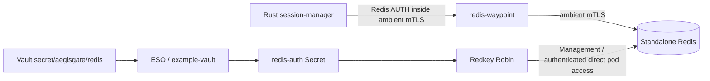

# Redis sessions with Redkey Operator 0.2.0

The example IPv6-only network requires the prepared
[Robin standalone compatibility patch](../../images/redkey-robin/README.md).
The example overlay selects that image; the installed operator remains 0.2.0.
The patched image is published publicly for amd64 and arm64 and digest-pinned
in the example overlay.

The `aegisgate-redis` Argo CD Application deploys a `Redkey` custom resource in
`aegisgate-cache`. The installed Redkey Operator and its Robin controller own
the Redis workload, configuration, headless Service, and management RBAC.
This application does not install a second operator.



## Configuration

- **Standalone, one primary, no replicas.** This matches the existing Rust
  `ConnectionManager` and its global session `SCAN`. Sharded Redis Cluster would
  require changes to client routing and session enumeration; changing `mode` is
  also immutable in Redkey.
- **Ephemeral sessions.** No PVC is requested, and both snapshots and AOF are
  disabled. A Redis pod replacement invalidates all sessions and pending logins.
  The cluster's default StorageClass is available if persistence is later chosen;
  it is not needed here. Redkey's `ephemeral` field is immutable: enabling storage
  requires a planned replacement, not an in-place flag change.
- **128 MiB Redis maxmemory, 256 MiB container limit, `noeviction`.** At capacity,
  new writes fail instead of silently evicting active sessions. This is a small
  demo deployment, not a highly available session store.
- **Pinned multi-architecture images.** Redis 8.10 (the pinned index reports
  8.10.3) and Robin 0.2.0 indexes were verified to contain `linux/amd64` and
  `linux/arm64`. No architecture selector or custom image build is required.
- **OpenShift security contexts.** Redis and Robin disallow privilege escalation,
  drop capabilities, and require a non-root UID. No fixed UID, privileged SCC,
  or `anyuid` grant is supplied; OpenShift assigns namespace-appropriate IDs.

## Vault and ESO

`ExternalSecret/redis-auth` uses `ClusterSecretStore/example-vault`, with the key
`aegisgate/redis` relative to its existing `secret` KV-v2 mount. The supplied
record fields are:

| Field | Expected value / use |
| --- | --- |
| `username` | `default`, validated for Redkey's `requirepass` authentication |
| `password` | Read from Vault; becomes the `password` key in `redis-auth` |
| `port` | `6379`, validated against the operator's port |
| `database` | `0`, validated against this demo's connection configuration |

ESO exposes numeric Vault properties as strings to the template. Incompatible
values or missing fields fail synchronization. Passwords must be nonempty and
use letters, digits, `_`, and `-`, matching the supplied record. This restriction
prevents newline/quote injection into Robin's unquoted Redis configuration and
ambiguous Redis URLs. Provide the password through your secret store.

**Operator behavior:** Robin 0.2.0 writes `requirepass` and `masterauth` into the
generated Redis ConfigMap. Treat ConfigMap reads in `aegisgate-cache` as credential
access, including Argo resource views and support exports. This is a property of
the requested operator, even though credentials originate in ESO-managed Secrets.

ESO refreshes hourly. Robin supports password changes, but the session manager's
environment is read at startup: coordinate Vault rotation, ESO reconciliation,
Robin's successful update, and a session-manager rollout. Do not assume rotating
a password revokes already-authenticated Redis connections or application sessions.

## Ambient and waypoint access

The namespace enrolls in ambient mode. Its **example overlay**, not the shared base,
adds `ambient-single-mesh: example-mesh`; use a different overlay label for another
cluster. Ensure the mesh discovers both cache and application namespaces.

The application endpoint is **`redis.aegisgate-cache.svc.cluster.local:6379`**.
This is a dedicated ClusterIP Service labeled to use `redis-waypoint`; Redkey's
own headless Service remains unchanged for Robin. The waypoint transports Redis
as TCP, not HTTP. There is no public Route, HTTPRoute, or external listener.

The Service-targeted waypoint policy accepts only
`cluster.local/ns/aegisgate/sa/session-manager`. The Redis pod policy accepts
only the waypoint and Redkey's generated `aegisgate-redis-robin` service account,
on port 6379. Robin intentionally manages pods directly. Application clients
cannot bypass the waypoint through the headless Service or pod IP. Strict mTLS
and the Redis password are both required. Adjust principals if the mesh trust
domain or namespaces differ.

NetworkPolicy permits HBONE and ambient's IPv4/IPv6 kubelet probe addresses.
Redkey's TCP health probes do not verify authentication; test AUTH separately.
Keep the session-manager and Robin pods enrolled in ambient mode. The waypoint
is selected on the application Service only, so Robin's direct management path
does not require an application-route exception.

## Connect the session-manager deployment

`deploy/gitops/redis/client` is a separate Kustomize resource set for the
application namespace, **not included in the Redis Argo application**. The
[application Kustomization](../application/base/kustomization.yaml) includes it.
It syncs the same Vault
record to `aegisgate/session-manager-redis`, rendering a `REDIS_URL` Secret key
with the internal endpoint, credentials, and database. The Secret remains local
to the consuming namespace. `example-vault` must allow reads from both namespaces.

Reference it in the session-manager container:

```yaml
env:
  - name: REDIS_URL
    valueFrom:
      secretKeyRef:
        name: session-manager-redis
        key: REDIS_URL
```

The URI uses `redis://`; transport encryption is supplied by ambient mTLS.
The session-manager must use service account `session-manager` in `aegisgate`,
and its namespace/pod must be enrolled in ambient. No application code change is
needed for standalone Redis authentication.

## Render, sync, and verify

```sh
kubectl kustomize deploy/gitops/redis/overlays/example
# Client integration, included by the application rollout:
kubectl kustomize deploy/gitops/redis/client
```

After pushing the reviewed files, import `deploy/gitops/application-redis.yaml`
through your existing Argo bootstrap/UI and sync it. The operator must serve
`redkey.inditex.dev/v1beta1` and watch `aegisgate-cache`; ESO must allow this
namespace. The mesh must supply `istio-waypoint`. GitOps needs permissions for
this namespace and the resources. No storage prerequisite is needed.

```sh
oc -n aegisgate-cache wait --for=condition=Ready externalsecret/redis-auth --timeout=180s
oc -n aegisgate-cache get redkey aegisgate-redis
oc -n aegisgate-cache get gateway redis-waypoint
oc -n aegisgate-cache get pods,services
```

Confirm the Redkey phase is `Ready` with its current observed generation and the
waypoint is `Programmed`. From the enrolled session-manager workload, verify an
authenticated PING and session expiry/revocation, then verify that anonymous
commands fail. Confirm waypoint traversal in mesh telemetry. Direct application
access to the Redis pod/headless Service and access from unrelated identities
must fail; Robin must still reconcile successfully.

The local template tests run with `cd tests/gitops && go test -v ./...` from the
repository root. They passed, including invalid credentials/connection fields
and configuration-injection rejection. The manifest was checked against the
upstream 0.2.0 Redkey CRD. An isolated container using the pinned Redis image and
generated configuration also passed arbitrary non-root UID startup, anonymous
command rejection, authenticated access, and the Rust store's idle/absolute
expiry and concurrent revocation test. Only disposable test credentials were
used; the container was removed afterwards.
Cluster admission, SCC, operator reconciliation, and mesh enforcement still need
live validation. Confirm that your Redkey operator watches the target namespace
before syncing.

Sources: [Redkey 0.2.0 standalone mode](https://github.com/InditexTech/redkey-operator/blob/0.2.0/docs/operator-guide/standalone-cluster.md),
[authentication](https://github.com/InditexTech/redkey-operator/blob/0.2.0/docs/operator-guide/authentication.md),
[supported overrides](https://github.com/InditexTech/redkey-operator/blob/0.2.0/docs/operator-guide/object-overrides.md),
[Robin configuration generation](https://github.com/InditexTech/redkey-robin/blob/0.2.0/internal/kubernetes/objects.go).
