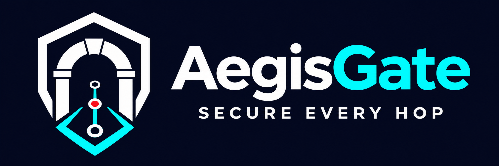
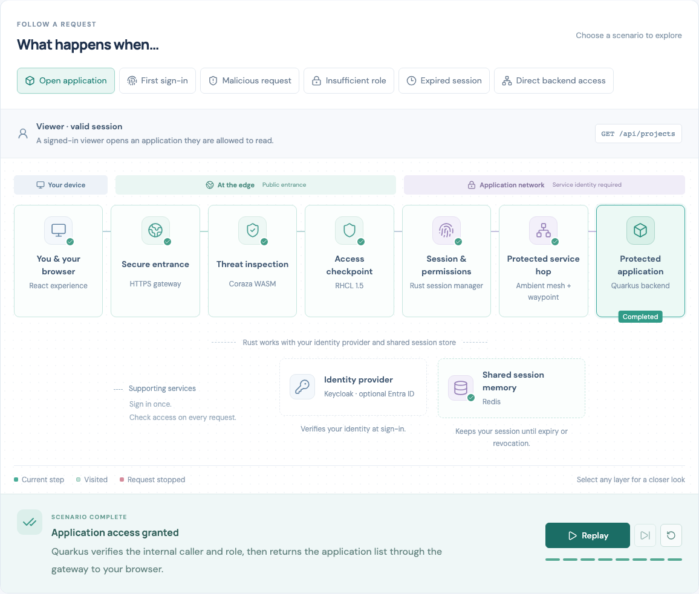
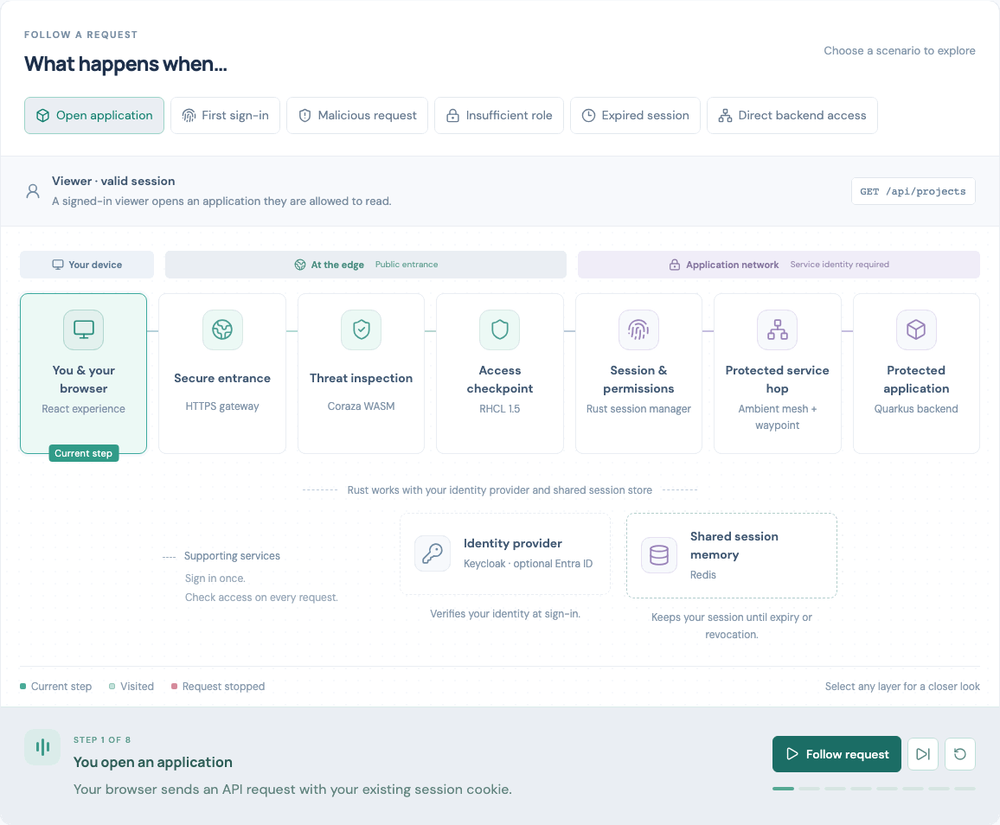

# AegisGate field guide

**Follow one request. Understand every decision.**

AegisGate demonstrates how a person signs in, receives a server-side session,
and reaches a protected application through several independent checks.
This guide connects the animated UI to the configuration and code that implement it.

[Start the walkthrough](how-it-works.md) · [Run the interactive guide](getting-started.md#explore-the-walkthrough) · [Deploy on OpenShift](../deploy/gitops/DEPLOYMENT.md)

## Choose your starting point

| I want to… | Start here | What you will learn |
| --- | --- | --- |
| Understand the demo in a few minutes | [How it works](how-it-works.md) | Six illustrated journeys, from a successful request to a blocked bypass |
| See the real service connections | [Architecture](architecture.md) | Gateway routes, Authorino decisions, waypoints, and trust boundaries |
| Understand login and session expiry | [Identity, sessions, and roles](identity-and-sessions.md) | OIDC, cookies, Redis, time limits, and exact permissions |
| Present and verify the demo | [Browser demo guide](demo-guide.md) | Actions to try, expected results, and evidence to inspect |
| Run my first local session | [Local setup](getting-started.md) | Installation, demo identities, and restart behavior |
| Install or operate the cluster | [OpenShift GitOps guide](../deploy/gitops/DEPLOYMENT.md) | Central Argo CD, operators, ESO, TLS, IPv6, and sync order |
| Build or extend the application | [Development reference](development.md) | Versions, multi-platform images, provider configuration, and tests |
| Improve these guides | [Documentation authoring](authoring.md) | Visual conventions, capture commands, and review checks |

## Three questions, three kinds of trust

| Question | Who answers it? | Example |
| --- | --- | --- |
| **Who are you?** | Keycloak, followed by Rust's verification of the signed identity result | “This person signed in and has the viewer role.” |
| **May you perform this action?** | Rust's session and RBAC checks; RHCL enforces the API decision | “A viewer may read projects, but may not run the operator action.” |
| **May this service reach that service?** | Ambient mesh identities and waypoint policies | “Only the session manager may call the backend through its waypoint.” |

Coraza adds another check at the entrance: **does the request match an attack rule?**
Quarkus checks the internal caller credential and role again before returning a response.

## A successful request, at a glance

The image is a teaching diagram captured from the UI. Its checkpoints explain the
order of decisions; the [architecture guide](architecture.md) shows the actual
network branches and the separate authorization call.

Play the captured walkthrough

## Know which environment you are reading about

| Environment | Included |
| --- | --- |
| **Local Compose** | React, Rust, Redis, Keycloak, Quarkus; login, sessions, RBAC, and CSRF |
| **OpenShift GitOps** | The application stack plus RHCL 1.5, Coraza, Service Mesh 3.5 ambient transport, waypoints, operator-managed identity/cache, and Vault-backed ESO secrets |

The animations are **illustrative scenarios**, not recordings of real attacks or
live cluster telemetry. The browser guide separates expected behavior from
[deployment verification](demo-guide.md#deployment-verification).

## Deployment bookshelf

[Keycloak and ESO](../deploy/gitops/README.md) · [Redis and Redkey](../deploy/gitops/redis/README.md) · [Application and policies](../deploy/gitops/application/README.md) · [Local installation](getting-started.md)

The separate [renderer-based OpenShift guide](openshift.md) describes the older
all-in-one installation. Use the OpenShift GitOps guide for the reference deployment;
the two installation paths own overlapping resources.

---

Next: **[How it works →](how-it-works.md)**
