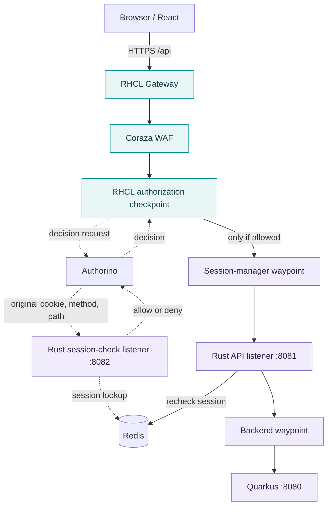
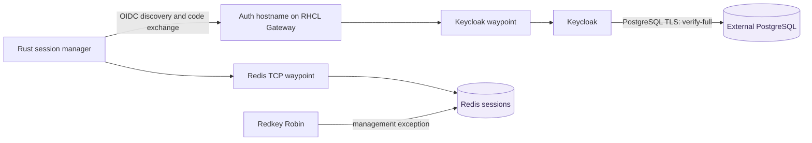
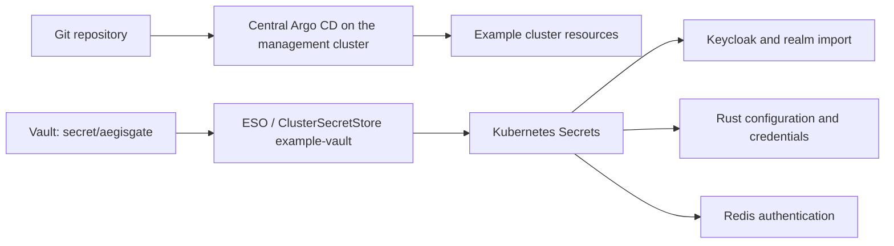

[Documentation home](README.md) / Architecture

# The path behind the picture

**The Gateway checks the request. Rust decides access. The mesh checks the caller.**

The UI walkthrough arranges these responsibilities into an easy-to-follow story.
The reference topology has branches: authorization is a separate call,
identity is consulted during sign-in, and Redis holds shared session state.

## The two paths behind one API request

**Dotted arrows are the authorization conversation. Solid arrows carry the API
request or its session lookup.** The Redis box is abbreviated here; Rust's
Redis traffic goes through the Redis Service's TCP waypoint.

Authorino calls `session-check:8082/internal/check` using its mesh identity.
This listener returns the access decision; it does not proxy the business API.
If allowed, the Gateway forwards the original request through the
session-manager waypoint to Rust on port 8081. Rust checks the session and RBAC
again before contacting Quarkus.

The private check Service intentionally has a separate path: The reference Authorino
has a sidecar, and its call is admitted by the session-manager workload's L4
policy on port 8082. The application/auth listener on 8081 requires its waypoint.
See the [transport policies](../deploy/gitops/application/base/mesh-policy.yaml)
and [Example principal substitutions](../deploy/gitops/application/overlays/example/kustomization.yaml).

## One Gateway, two public names

| Host / path | Destination | Requires an application session? |
| --- | --- | --- |
| `demo.aegisgate.example.com/` | React UI | No; the shell and walkthrough are public |
| `demo.aegisgate.example.com/api/*` | Rust through its waypoint | Yes; RHCL checks first, Rust checks again |
| `demo.aegisgate.example.com/auth/login/keycloak` | Rust login handler | No |
| `demo.aegisgate.example.com/auth/callback` | Rust OIDC callback | Requires valid one-use login state, not an existing session |
| Other `/auth/*` endpoints | Rust session endpoints | Endpoint-specific: current-session reads, logout, and admin operations have their own checks |
| `auth.aegisgate.example.com/` | Keycloak through its waypoint | Keycloak applies its own login/admin rules |
| `/health/ready` on either hostname | Gateway's native readiness endpoint | No |

All these public paths remain covered by the Gateway-targeted Coraza plugin.
“Public” means an application session is not required; it does not disable WAF
inspection. The readiness HTTPRoute rewrites `/health/ready` to `/healthz/ready`
and reaches Envoy's internal readiness Service. It reports **Gateway readiness**,
not the health of every application dependency.

The example uses an IPv6 LoadBalancer for this Gateway. The older renderer installation
uses a different ingress arrangement; do not infer an example passthrough OpenShift
Route from that older path or from the UI's general explanation.

## Who may call whom

| Boundary | Allowed caller | Enforcement |
| --- | --- | --- |
| Public API/auth → Rust :8081 | AegisGate Gateway through the session-manager waypoint | Service-level waypoint policy plus workload L4 policy |
| Session check → Rust :8082 | The reference Authorino service account | Workload principal and port restriction |
| Rust → Quarkus | Session-manager service account through the backend waypoint | Waypoint checks identity/method/path; backend transport accepts its waypoint |
| Rust → Redis | Session-manager service account through the Redis waypoint | TCP waypoint policy, Redis workload policy, and Redis authentication |
| Robin → Redis | Redkey Robin service account | Explicit direct management exception for port 6379 |
| Gateway → Keycloak | AegisGate Gateway through the identity waypoint | Keycloak waypoint and workload policies |
| Gateway → React | AegisGate Gateway identity | Web UI workload transport policy |

Example principals illustrate the `mesh.example.com` trust domain. The mesh discovery
label `ambient-single-mesh: example-mesh` is supplied by **Kustomize overlays**, so a
different cluster can substitute its own discovery label and trust domain.

A **waypoint** is a proxy that applies service-level policy. **ztunnel** provides
ambient transport identity and mTLS. An mTLS connection proves a service identity;
it does not, by itself, grant a user permission to perform a business action.
The application pods do not need individual sidecars for ambient enrollment.

## Identity and state live on separate branches

Keycloak verifies identity during sign-in. Its realm and user records persist in
external PostgreSQL. Redis holds AegisGate sessions, short-lived login state, and
the bounded demo activity log. The supplied Redkey configuration is ephemeral:
a Redis restart loses this state and users must create new application sessions.
An existing default StorageClass does not make this Redis configuration persistent.

## GitOps supplies configuration; Vault supplies values

The four Argo applications separate Gateway, Keycloak, Redis, and application
resources. Operators reconcile their own workloads; Argo owns the declarative
custom resources and policies. Credentials are referenced through ESO rather
than embedded in Git. The public realm name is the literal `aegisgate` because
the Keycloak operator uses it to form an import filename before substituting
Secret-backed placeholders.

## What each protection does—and where it stops

| Protection | It checks | It does not replace |
| --- | --- | --- |
| HTTPS | Server identity and encrypted browser transport | User authentication or input inspection |
| Coraza + CRS | Requests matching configured attack rules | RBAC or application validation |
| OIDC | Signed identity result, issuer, audience, nonce, expiry | Per-request authorization |
| Redis-backed sessions | Whether the application's session remains usable | A live query of every current IdP role |
| Rust RBAC | Exact HTTP method and path against mapped roles | CSRF checks or service identity |
| Origin + CSRF checks | Whether a write carries the expected origin and token | Permission to perform the action |
| Ambient mesh policies | Which service identity may cross each boundary | End-user roles |
| Quarkus checks | Internal credential and allowed role | Public identity-provider login |

The internal backend credential is shared configuration, not a user JWT.
Rust supplies it with mapped role headers; Quarkus validates them. Browser-supplied
identity headers are not accepted as the source of identity.

## Follow the implementation

| Topic | Source |
| --- | --- |
| Public routing | [Application HTTPRoutes](../deploy/gitops/application/base/routes.yaml) |
| Private decision endpoint | [Services](../deploy/gitops/application/base/services.yaml), [AuthPolicy](../deploy/gitops/application/base/authpolicy.yaml) |
| WAF rules and artifact pin | [Coraza WasmPlugin](../deploy/gitops/application/base/coraza-waf.yaml) |
| Session/API enforcement | [Rust handlers](../session-manager/src/main.rs) |
| Shared session semantics | [Redis store](../session-manager/src/store.rs) |
| Browser OIDC flow | [OIDC handlers](../session-manager/src/oidc.rs) |
| Example TLS and readiness | [Gateway overlay](../deploy/gitops/gateway/overlays/example/kustomization.yaml), [readiness route](../deploy/gitops/gateway/base/readiness.yaml) |

---

[← How it works](how-it-works.md) · **[Identity, sessions, and roles →](identity-and-sessions.md)**
