[Documentation home](README.md) / How it works

# One request. Every layer.

**Six stories explain what AegisGate allows, what it refuses, and why.**

Each showcase comes from the application's **How it works** screen. Start with
the still image, read the steps, then expand the animation if you want to follow
it visually. The text contains the complete explanation, including when motion
is disabled or your Markdown viewer does not play GIFs.

[01 Open an application](#01-open-an-application) · [02 First sign-in](#02-first-sign-in) · [03 Malicious request](#03-malicious-request) · [04 Insufficient role](#04-insufficient-role) · [05 Expired session](#05-expired-session) · [06 Direct backend access](#06-direct-backend-access)

> These are illustrative journeys. They do not send traffic or prove that a
> deployed policy is working. Use the [browser demo guide](demo-guide.md) for live checks.

## 01 Open an application

**Person:** signed-in viewer · **Request:** `GET /api/projects` · **Result:** application data

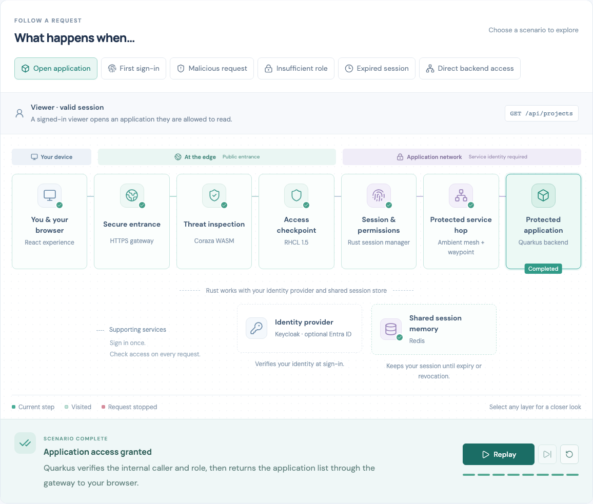

Watch the successful request — eight steps

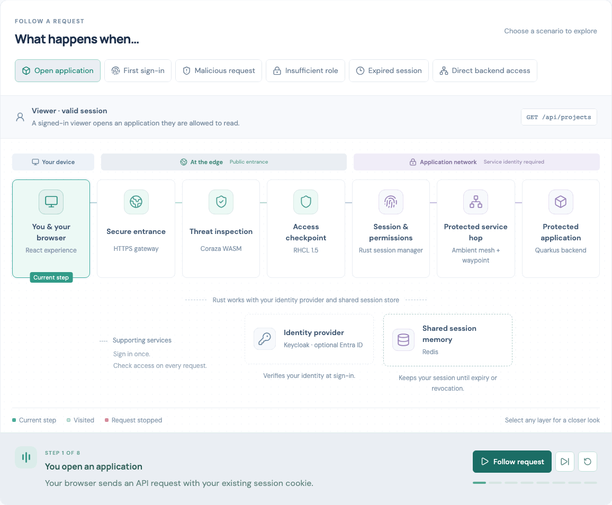

1. **The browser asks for projects.** It sends its opaque session cookie with a same-origin API request.
2. **The Gateway receives HTTPS.** The hostname and path select the application API route.
3. **Coraza inspects the request.** No configured attack rule blocks this example.
4. **RHCL requests an access decision.** Authorino calls Rust's private session-check endpoint with the original cookie, method, and path.
5. **Rust reads Redis.** A live session supplies the user's mapped roles and expiration limit.
6. **Rust allows this exact action.** Viewers may read projects. The request is then forwarded through the session-manager waypoint to Rust's API listener, which rechecks authorization.
7. **The backend waypoint checks the service identity.** The caller must be the session-manager service account and the method/path must be allowed.
8. **Quarkus checks the internal credential and role.** It returns the project list; the response travels back to the browser.

**What this demonstrates:** a successful login establishes identity, but each
protected request still passes session, permission, service-identity, and backend checks.

[See the exact network path →](architecture.md#the-two-paths-behind-one-api-request)

## 02 First sign-in

**Person:** new visitor · **Request:** `GET /auth/login/keycloak` · **Result:** a new application session

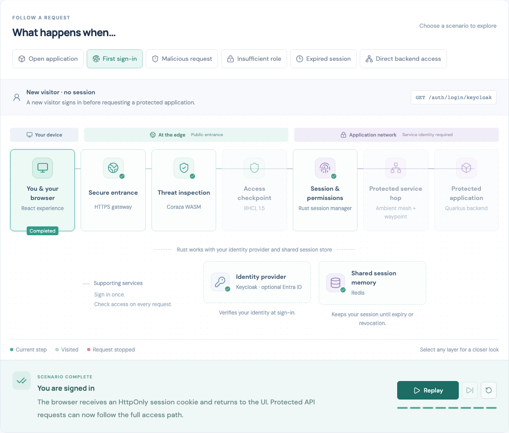

Watch first sign-in — eight steps

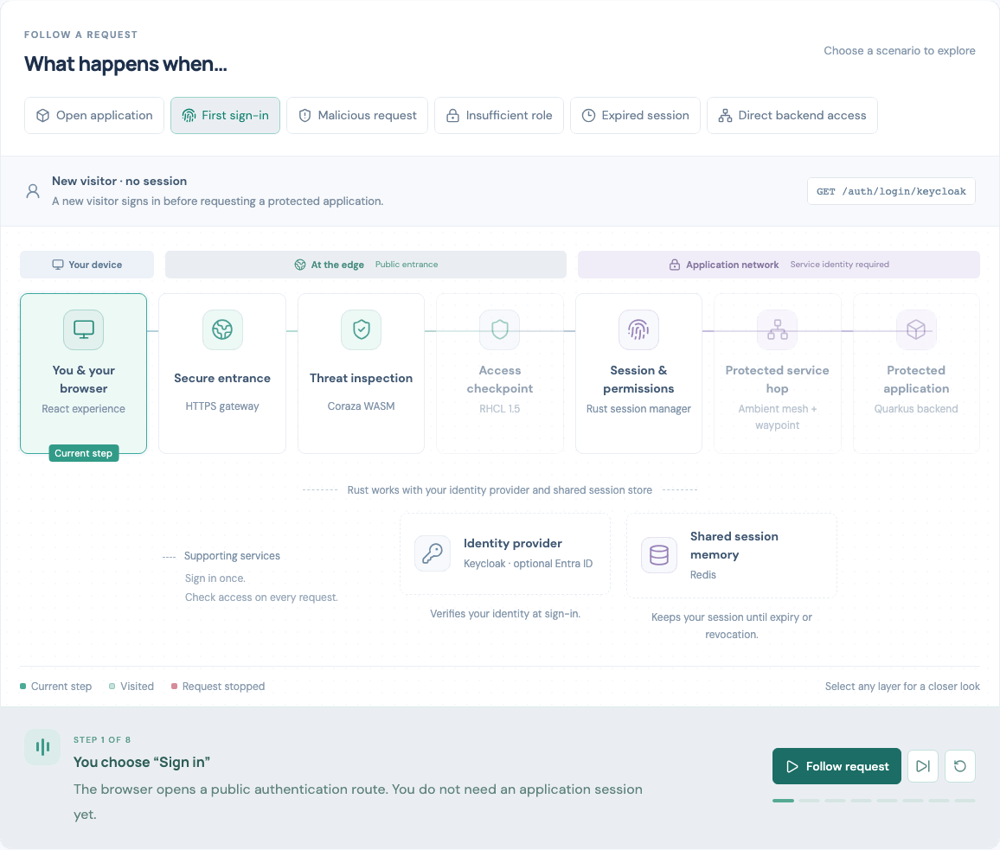

1. **The visitor chooses Keycloak.** The authentication route is reachable before an application session exists.
2. **The Gateway selects `/auth`.** The API AuthPolicy does not require an existing session for the login or callback path.
3. **Coraza still inspects the request.** Public login routes remain covered by the Gateway WAF.
4. **Rust prepares the login.** It creates browser-bound state, a nonce, and a PKCE challenge. Temporary state lives in Redis for five minutes.
5. **Keycloak authenticates the person.** In the example deployment, its public hostname is `auth.aegisgate.example.com`, reached through the shared RHCL Gateway and the identity waypoint.
6. **Rust validates the callback.** It consumes the one-use state, exchanges the authorization code using the PKCE verifier, and validates the signed identity result.
7. **Rust creates the session.** Verified provider roles are mapped to application roles. Redis stores the session under a hash of a new random identifier.
8. **The browser receives an HttpOnly cookie.** React does not receive the provider tokens. The user can now request protected data.

**What this demonstrates:** the identity provider proves who the user is; Rust
creates and manages the application's own session. Entra ID can be configured
as another OIDC provider, but the supplied example configuration enables Keycloak.

[Explore login and provider mapping →](identity-and-sessions.md#sign-in-without-exposing-provider-tokens)

## 03 Malicious request

**Person:** any visitor · **Request:** an XSS test query · **Result:** blocked at the Gateway

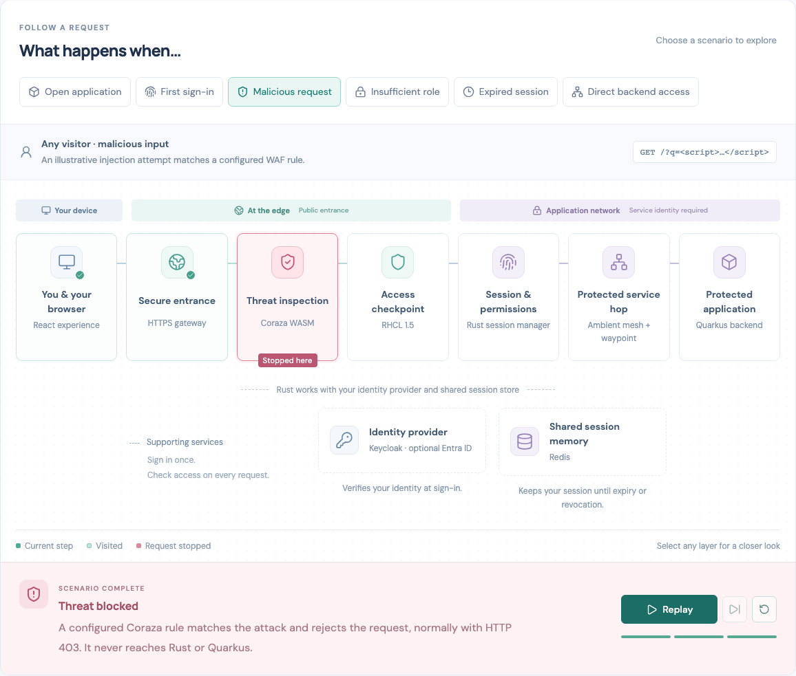

Watch the WAF stop a request — three steps

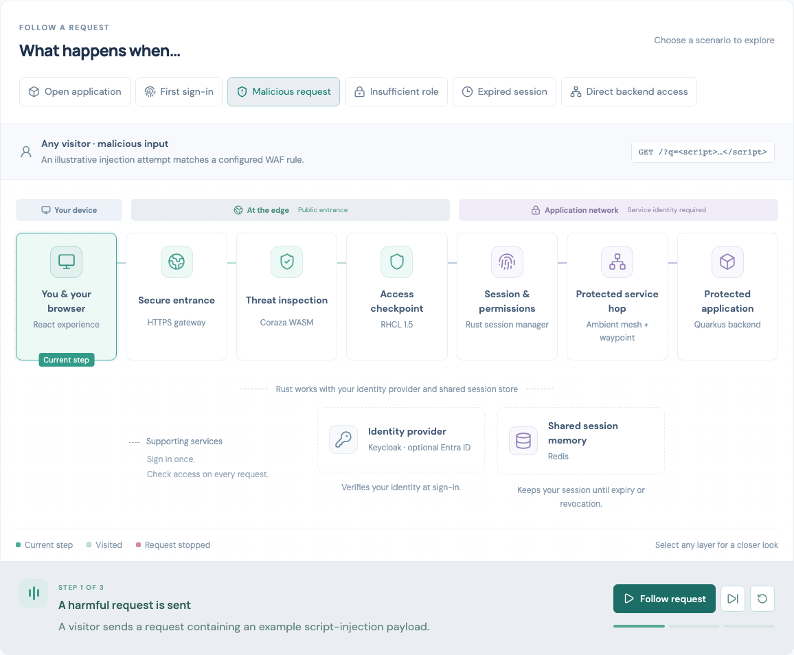

1. **A visitor sends an injection-shaped query.** A session is not required to request the public homepage.
2. **The Gateway receives it over HTTPS.** Encryption protects transport; it does not make the request content trustworthy.
3. **Coraza matches an attack rule.** In blocking mode, the matching request receives a denial, normally HTTP 403, before application handling.

**What this demonstrates:** WAF inspection also protects public routes. A WAF
match and an authorization denial can both return 403, so confirm the cause in
Coraza logs instead of relying on the browser status alone.

[Try the harmless browser test →](demo-guide.md#2-watch-coraza-stop-a-test-request)

## 04 Insufficient role

**Person:** signed-in viewer · **Request:** `POST /api/deployments` · **Result:** permission denied

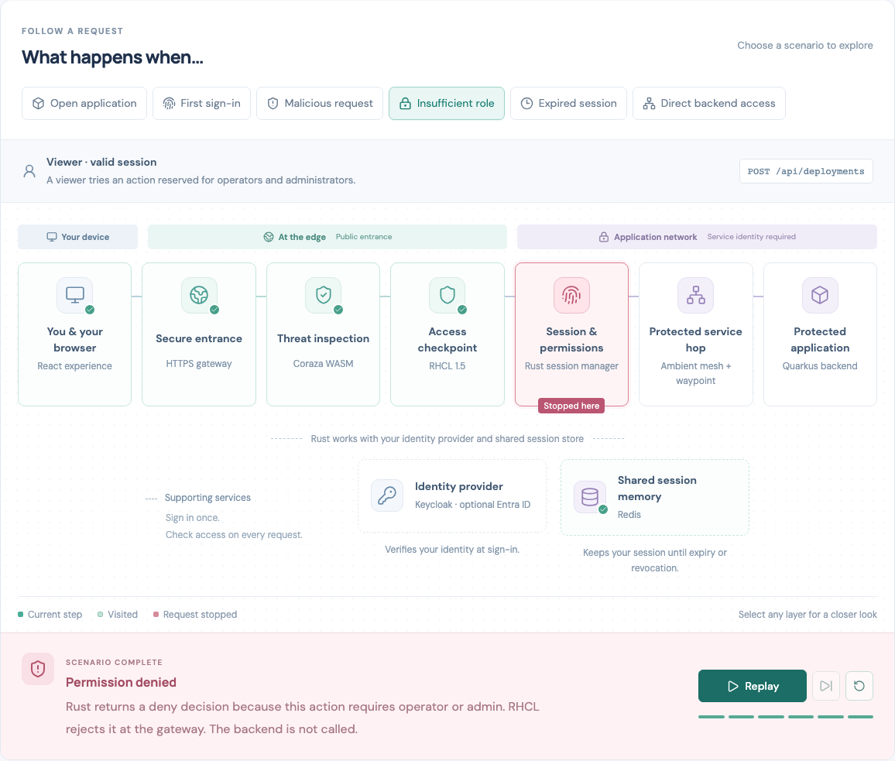

Watch a role denial — six steps

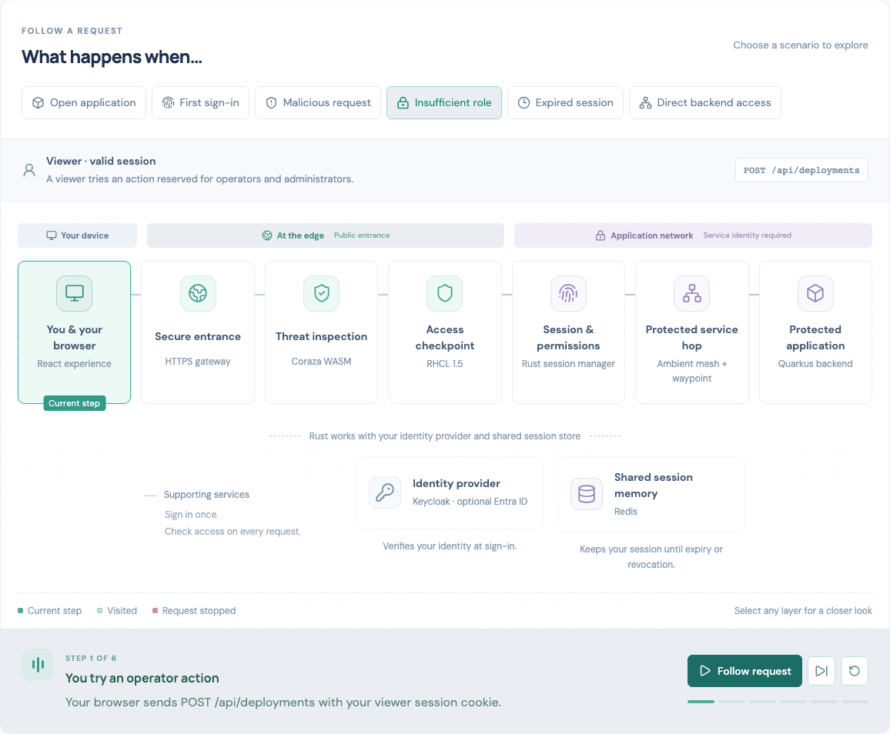

1. The viewer attempts the operator action through the UI.
2. The request reaches the HTTPS Gateway and passes WAF inspection.
3. Authorino asks Rust whether this session may perform this method and path.
4. Redis contains a valid session, but its mapped role is only `viewer`.
5. Rust's rule for `POST /api/deployments` requires `operator` or `admin`.
6. The Gateway rejects the API request. Quarkus is not called for this denied action.

**What this demonstrates:** “signed in” and “allowed” are separate decisions.
Operator/admin writes must also pass Rust's same-origin and CSRF checks when
forwarded. The demo action returns a sample result; it does not deploy a workload.

[Read the permission matrix →](identity-and-sessions.md#the-permission-matrix)

## 05 Expired session

**Person:** returning viewer · **Request:** `GET /api/projects` · **Result:** sign-in required

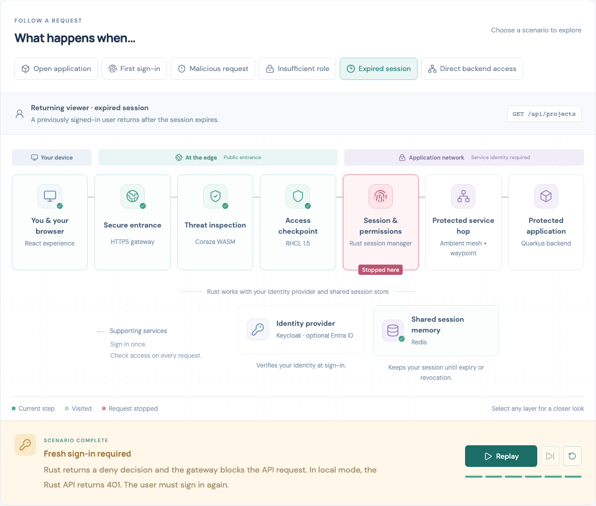

Watch session expiry — six steps

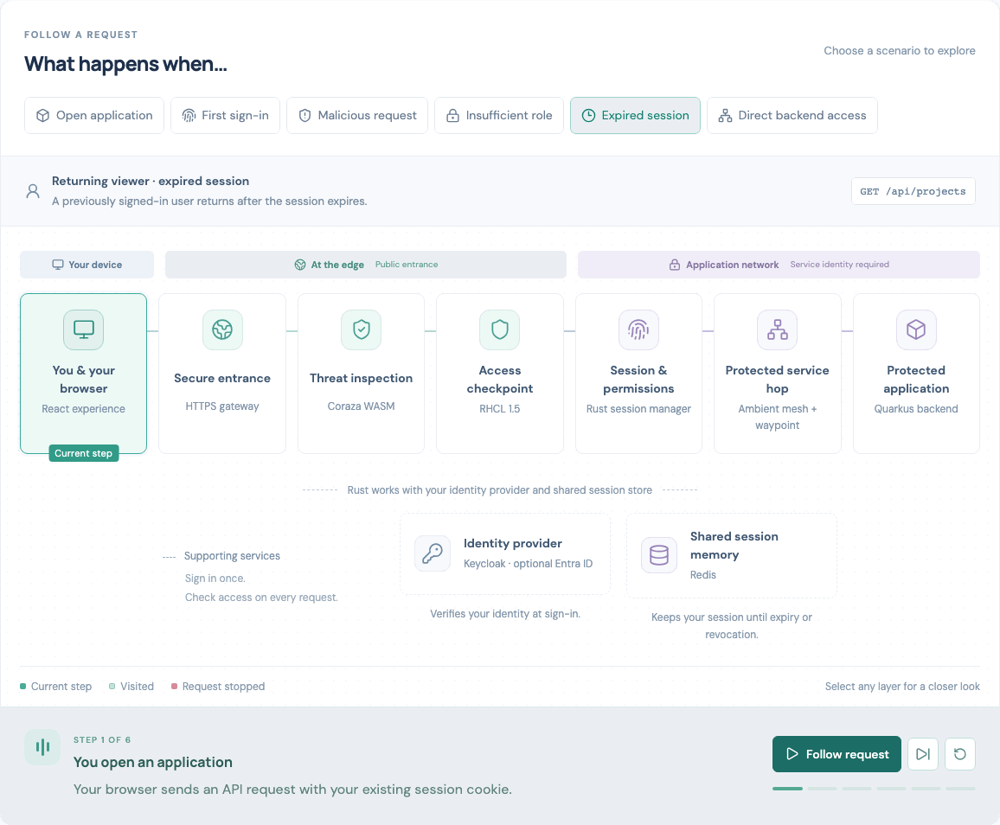

1. The browser sends its old session cookie.
2. HTTPS routing and WAF inspection still happen normally.
3. Authorino asks for a fresh session decision.
4. Rust cannot find a usable session: its idle TTL expired, its absolute limit was reached, or it was deleted.
5. The access decision is denied. A cookie by itself cannot restore the session.
6. The user starts sign-in again. Keycloak may still have a valid SSO session and complete the login without asking for the password again.

**What this demonstrates:** server-side expiry and revocation control access,
not the presence of a browser cookie. In the example deployment, the API AuthPolicy can return
403 for this denial; direct Rust session endpoints return 401 for a missing session.

**Current limits:** 15 minutes idle, at most one hour from login, and no later
than the verified ID token's expiry. [See the timeline →](identity-and-sessions.md#two-clocks-limit-every-application-session)

## 06 Direct backend access

**Caller:** unrelated workload · **Request:** direct call to Quarkus · **Result:** mesh policy denial

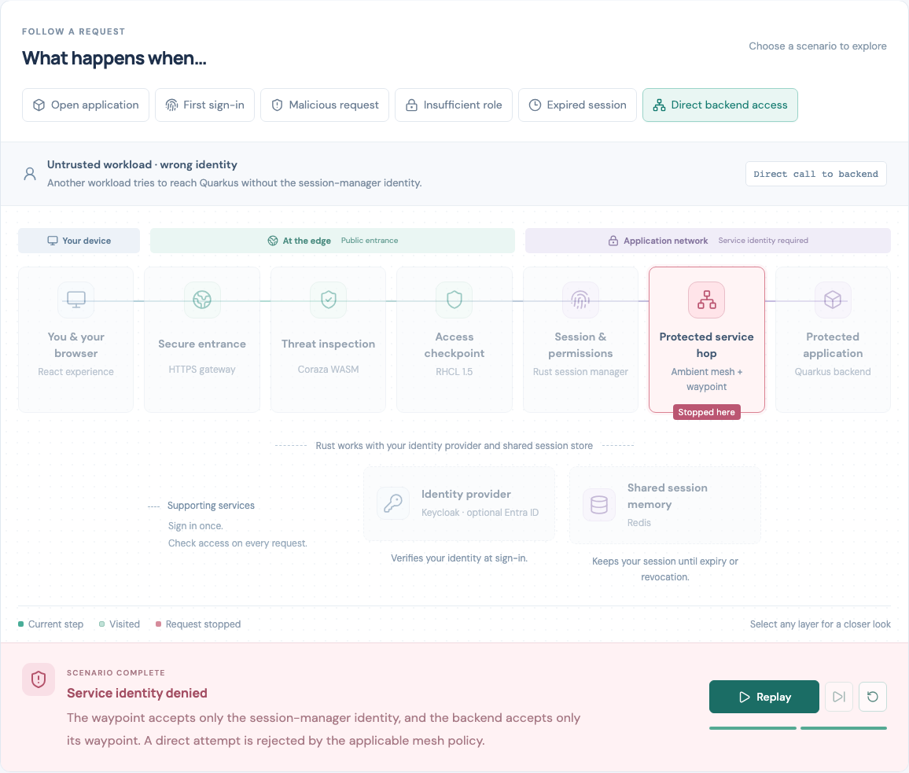

Watch a bypass attempt — two steps

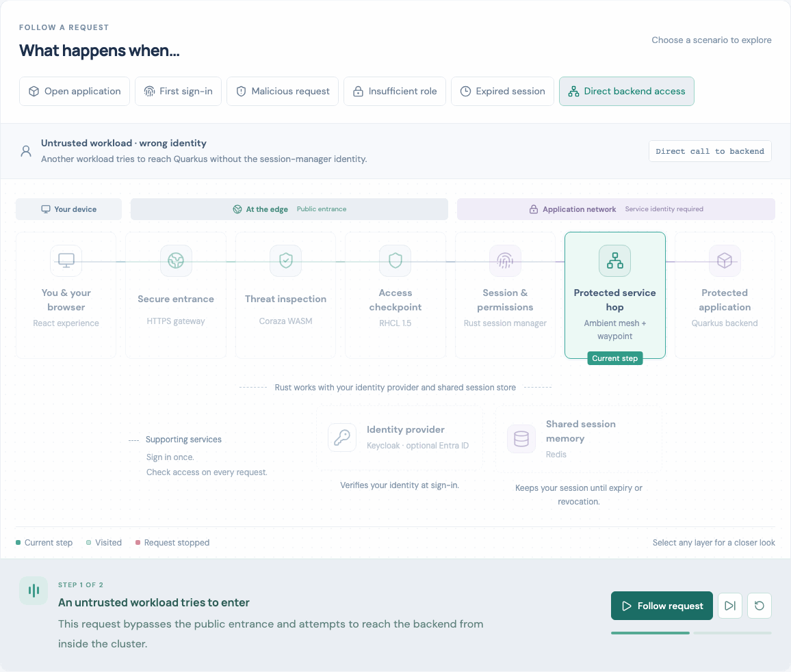

1. A workload tries to call the backend without going through the authorized application path.
2. A request through the backend Service must pass the waypoint policy, which permits the session-manager identity. A direct pod attempt must pass the backend transport policy, which permits its waypoint identity. The unrelated caller satisfies neither condition.

**What this demonstrates:** being inside the cluster is not sufficient permission.
Even on the permitted service path, Quarkus independently checks the internal
credential and role. A browser cannot prove this mesh boundary; it requires a
controlled in-cluster test with a different service account.

[Understand the service boundaries →](architecture.md#who-may-call-whom)

## Bring the stories together

| Scenario | Decisive check | Expected result |
| --- | --- | --- |
| Open application | Session, permitted action, service identity, backend checks | Data returned |
| First sign-in | Verified OIDC callback | New Redis session and browser cookie |
| Malicious request | Coraza rule match | Gateway denial |
| Insufficient role | Rust method/path RBAC | Gateway denial |
| Expired session | Redis TTL / absolute expiry | Fresh application sign-in |
| Direct backend access | Mesh service identity | Connection or request rejected |

---

[← Documentation home](README.md) · **[Architecture →](architecture.md)** · [Run the browser demo](demo-guide.md)
