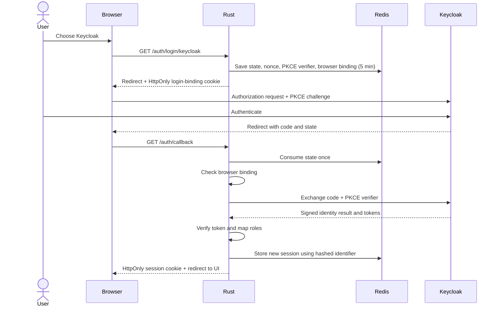

[Documentation home](README.md) / Identity, sessions, and roles

# Sign in once. Check access on every request.

**The browser keeps an opaque cookie. Redis keeps the session. Rust decides what it permits.**

AegisGate uses Keycloak to establish identity and creates its own server-side
session after validating the OIDC response. Provider tokens are not returned to
React and are discarded after the login checks; the application does not silently
refresh them.

## Sign-in without exposing provider tokens



This sequence omits Gateway and mesh hops for readability; the browser and Rust
reach Keycloak through the [deployed routing path](architecture.md).

Rust checks the ID-token signature, issuer, audience, nonce, and expiry, and the
access-token hash when present. Only then does it read provider-specific role
claims. A successful new login replaces the browser's previous application
session identifier.

## Two clocks limit every application session

| Clock | Current configuration | Meaning |
| --- | --- | --- |
| **Idle limit** | 900 seconds / **15 minutes** | Each successful session lookup renews the Redis TTL, up to the remaining absolute lifetime |
| **Absolute limit** | 3,600 seconds / **1 hour** | Activity cannot extend the session beyond one hour from creation |
| **ID-token cap** | Token's verified expiry | A token that expires earlier shortens the application session |
| **Pending login** | 300 seconds / **5 minutes** | Temporary OIDC state and its browser-binding cookie expire |

The effective deadline is:

```text
absolute deadline = earlier of (login time + 1 hour, verified ID-token expiry)
Redis TTL after a successful lookup = smaller of (15 minutes, time until deadline)
```

For example, with an ID token valid through 11:00:

| Time | Event | Session consequence |
| --- | --- | --- |
| 10:00 | Sign-in succeeds | Redis TTL starts at 15 minutes; absolute deadline is 11:00 |
| 10:10 | Authenticated request checks the session | Idle deadline advances to 10:25 |
| 10:25 | No further session checks occurred | The application session expires from inactivity |
| 10:55 | Alternative: the user has remained active throughout | TTL can extend only five more minutes |
| 11:00 | Absolute deadline arrives | Sign-in is required regardless of activity |

“Activity” means a request that looks up the session, not mouse movement or an
open browser tab. A background API poll can count; an unrelated public readiness
probe cannot. A session lookup may refresh the idle timer even if a later role
check rejects that action.

The cookie's lifetime follows the absolute deadline, so the browser may still
hold a cookie after the shorter Redis idle timeout. The server-side record is
the authority on whether access remains valid.

## Two sessions can end at different times

| Session | Owned by | Idle / maximum | What happens when it ends? |
| --- | --- | --- | --- |
| AegisGate application session | Rust + Redis | 15 min / up to 1 hour | Protected application access is denied |
| Keycloak SSO session | Keycloak | Realm import configures 30 min / 1 hour | Keycloak requires authentication again |

Logging out of AegisGate deletes the Redis session and clears the application
cookie. It does not perform provider-wide logout. If Keycloak SSO remains valid,
a new application sign-in may complete without asking for the password again.
The realm import is create-once; changing its timeout fields in Git does not
update an already imported realm.

## The permission matrix

Provider roles are explicitly mapped before authorization:

| Keycloak role | Application role |
| --- | --- |
| `aegis-viewer` | `viewer` |
| `aegis-operator` | `operator` |
| `aegis-admin` | `admin` |

| Action | Viewer | Operator | Admin |
| --- | :---: | :---: | :---: |
| `GET /api/projects` | ✓ | ✓ | ✓ |
| `GET /api/overview` | ✓ | ✓ | ✓ |
| `POST /api/deployments` | — | ✓ | ✓ |
| `GET /api/admin` | — | — | ✓ |
| List/revoke sessions and view the activity log | — | — | ✓ |

The four `/api` rules match exact methods and paths. Other actions are denied
unless a handler explicitly supports and authorizes them. The session-management
handlers separately enforce administrator access. Writes also require the
expected `Origin` and session-specific `X-CSRF-Token`.

## What Redis stores

| Record | Purpose | Lifetime |
| --- | --- | --- |
| `login:<hash>` | One-use OIDC state, nonce, PKCE verifier, and browser binding | Five minutes or successful consumption |
| `session:<hash>` | Subject, display name, provider, mapped roles, CSRF value, creation/expiry times | Sliding idle TTL bounded by absolute expiry |
| `audit` | Recent demo access-decision events | Bounded to 200 entries; the UI reads up to 100 |

Session keys contain a hash of the opaque identifier, not the raw browser cookie.
The session data still contains identity information and must be treated as
sensitive. Redis authentication and mesh policies restrict access.

The supplied Redis deployment is ephemeral. Restarting it clears sessions,
pending logins, and the activity log. It is not a durable audit store.

## Expiry, revocation, and role changes

- **Logout:** deletes the current Redis session and clears the browser cookie.
- **Administrator revocation:** deletes the selected session. Its next lookup fails.
- **Idle or absolute expiry:** invalidates the session even if a browser cookie remains.
- **Role change or disabled user at the provider:** does not rewrite an existing Redis session. Revoke it or wait for expiry, then sign in again to obtain current claims.

The session read and TTL update are atomic, so a concurrent read cannot recreate
a deleted session. Revocation affects subsequent checks; it cannot retract a
request that has already passed its final authorization check.

## Adding another identity provider

The adapter is configured by issuer URL, client ID, secret environment variable,
role-claim pointer, and explicit role mapping. Keycloak uses `/realm_access/roles`.
The [Entra example](../session-manager/provider-entra.example.json) uses `/roles`
and a tenant-specific issuer. Entra requires its own app registration and credentials.

Register `https://demo.aegisgate.example.com/auth/callback` in your customized deployment. Keep the
provider secret in Vault/ESO and supply it through the referenced environment
variable. In the GitOps installation, edit the ESO-generated configuration in
[external-secrets.yaml](../deploy/gitops/application/base/external-secrets.yaml)
and the workload environment, then sync and roll out Rust to load it. Editing the
local Compose configuration alone does not change the cluster configuration.

## Source of truth

[Configured limits and rules](../deploy/gitops/application/base/external-secrets.yaml) · [OIDC validation](../session-manager/src/oidc.rs) · [Atomic expiry logic](../session-manager/src/store.rs) · [Keycloak realm](../deploy/gitops/keycloak/base/realm-import.yaml)

---

[← Architecture](architecture.md) · **[Browser demo guide →](demo-guide.md)**
